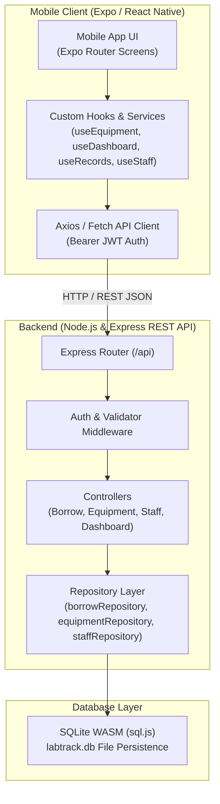
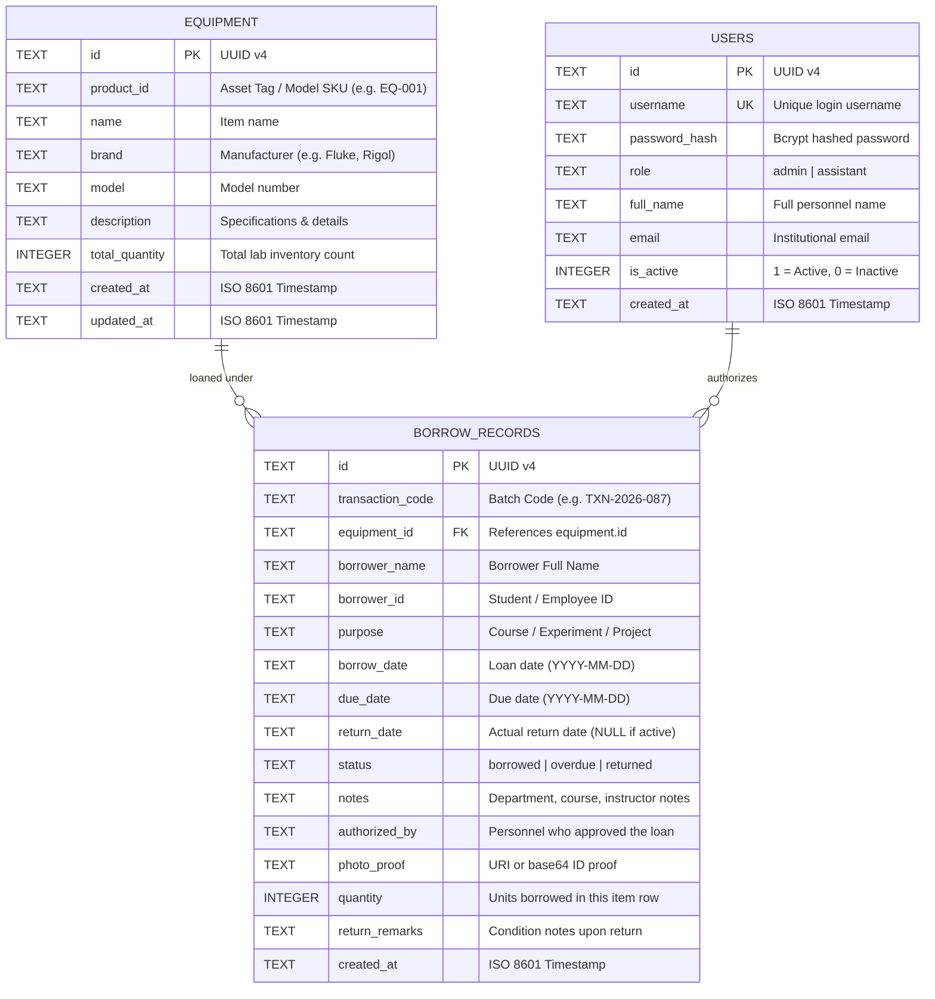

# LabTrack — Laboratory Borrowing Management System

[](https://reactnative.dev/)
[](https://expo.dev/)
[](https://nodejs.org/)
[-lightgrey.svg)](https://sqlite.org/)
[](https://www.typescriptlang.org/)

**LabTrack** is a mobile-first laboratory equipment borrowing and inventory management system engineered for educational and research engineering laboratories (UMTC Engineering Laboratories). It streamlines the equipment loan process, eliminates manual paper-based logs, tracks equipment condition across multi-item transactions, and enforces accountability through role-based access control.

---

##  Key Features

- **Authentication & Role-Based Access Control (RBAC):** Admin (laboratory custodian) and Assistant roles with protected staff management routes.
- **Home & Live Analytics Dashboard:** Real-time metrics on total laboratory assets, currently borrowed units, overdue loans, and quick return actions.
- **Equipment Inventory Catalog:** Search, category filtering, real-time availability status (*Available*, *Partial*, *Out*), asset-tag tracking, and specifications detail.
- **Multi-Step Borrowing Transaction Wizard:**
  - **Step 1 — Borrower Information:** Student/Faculty identification, college department, subject, schedule, purpose, and contact number.
  - **Step 2 — Equipment Selection:** Interactive quantity stepper, real-time stock validation, and multi-item cart.
  - **Step 3 — Duration & Dates:** Preset loan durations (Overnight, Standard, Extended), custom schedule selection, and notes.
  - **Step 4 — Review & Authorization:** Custodian approval, optional digital proof/photo upload, and generation of official transaction codes (`TXN-YYYY-XXX`).
- **Comprehensive Return Processing:** Check off returned items, assign condition grades (*1: Good*, *2: For Replacement*, *3: For Repair*, *4: Consumable*), log return remarks, and instantly restore inventory counts.
- **Staff Directory & Custodian Management:** View laboratory personnel, add staff members, toggle active/inactive status, and manage permissions.

---

## 🛠️ Technology Stack

| Layer | Technologies |
| :--- | :--- |
| **Mobile Frontend** | React Native, Expo SDK 52, Expo Router v4, React Native Safe Area Context, Vector Icons |
| **Backend API** | Node.js, Express.js REST API, TypeScript, ts-node-dev |
| **Database** | SQLite (via `sql.js` WebAssembly engine with disk persistence to `labtrack.db`) |
| **Authentication** | JSON Web Tokens (JWT), bcryptjs password hashing |
| **Type Safety** | TypeScript (Strict Mode) across both Frontend and Backend |

---

## 🏛️ System Architecture



---

## 🗄️ Database Structure & ERD

The relational database uses **SQLite** stored persistently in `backend/labtrack.db`.



---

## 🚀 Getting Started

### Prerequisites
- Node.js (v18 or higher recommended)
- npm or bun
- Expo Go app on your physical mobile phone, or Android Studio Emulator

### 1. Clone the Repository
```bash
git clone https://github.com/drei-cabal/LabTrack-Laboratory-Borrowing-Management-System.git
cd LabTrack-Laboratory-Borrowing-Management-System
```

### 2. Install Dependencies
```bash
# Install root, backend, and frontend packages
npm install
npm --prefix ./backend install
npm --prefix ./frontend install
```

### 3. Start the Backend API Server
```bash
npm run backend
```
The REST API will initialize the SQLite database (`labtrack.db`), seed initial laboratory equipment and default staff accounts, and listen on `http://localhost:3001`.

### 4. Start the Mobile Frontend
```bash
npm run start
```
- Press `a` to open in Android Emulator.
- Press `w` to run in Web Browser.
- Scan the QR code using the **Expo Go** app on your physical mobile device.

> **Note for Physical Device Testing:**
> Set your computer's local IP address in `frontend/.env`:
> ```env
> EXPO_PUBLIC_API_URL=http://<YOUR_LOCAL_IP>:3001/api
> ```

---

## 🧪 Default Test Credentials

| Full Name | Username | Password | Role |
| :--- | :--- | :--- | :--- |
| **Prof. Eduardo Cruz** | `admin.cruz` | `admin123` | **Admin** |
| **Karen Dela Cruz** | `k.delacruz` | `staff123` | **Assistant** |
| **Marco Villanueva** | `m.villanueva` | `staff123` | **Assistant** |

---

## 📦 Building Standalone APK

To generate an installable Android APK file:
```bash
cd frontend
npx eas-cli build -p android --profile preview
```
